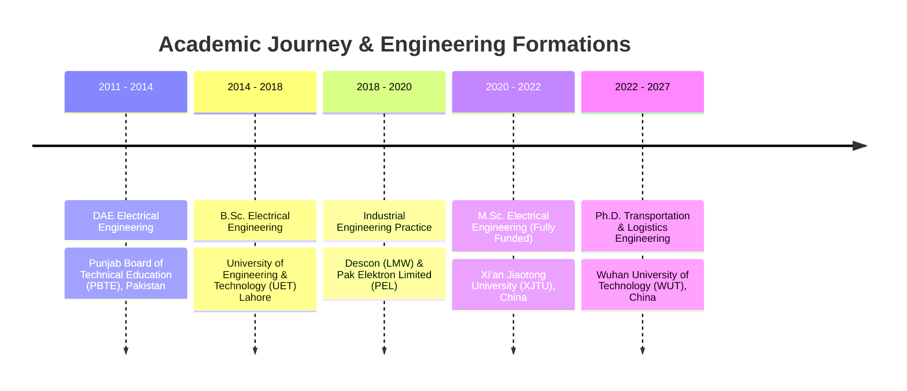

# 👨‍🔬 Engr. Umer Bashir

### **Ph.D. Researcher in Transportation & Logistics Engineering**
**Wuhan University of Technology (WUT) · Wuhan, China**  
*M.Sc. Electrical Engineering (XJTU) · B.Sc. Electrical Engineering (UET Lahore)*

 

 

> *"Bridging Physical Transport Topography, Outlier-Resilient Machine Learning, and Enterprise Fleet Control Towers."*

---

## 🧭 Executive Profile

I am an **Electrical Engineer and Ph.D. Researcher in Transportation & Logistics Engineering** at **Wuhan University of Technology (WUT)**, Wuhan, China. My research focuses on solving fundamental bottlenecks in freight supply chains through **spatio-temporal machine learning**, **topography-adaptive road circuity modeling**, and **autonomous fleet exception dispatching**.

Prior to my doctoral studies, I completed an **M.Sc. in Electrical Engineering** at **Xi’an Jiaotong University (XJTU)**, China on a **fully funded scholarship**, where I was awarded the *Excellent Student Certificate* at the XJTU Silk Road International Programme. My academic foundation was built with a **B.Sc. in Electrical Engineering** from the **University of Engineering & Technology (UET) Lahore**, complemented by hands-on industrial engineering experience at multinational leaders **Pak Elektron Limited (PEL)** and **Descon (LMW)**.

- 🔭 **Current Focus**: Large-scale intercity freight ETA prediction, digital elevation gradient modeling ($\Delta h$), robust Huber gradient boosting, and sub-millisecond dispatch engines.
- 🎓 **International Fellow**: UNESCO-backed **IKCEST Silk Road International Fellow** in *Machine Learning from Scratch* (tree ensembles, regularized optimization, neural networks).
- 🤝 **Community Leadership**: Active in **IEEE Region 10 Young Professionals** (UpSkill Malaysia), conference organizing committees (PGSRET), and academic society initiatives.

---

## 🔬 Featured Research & Flagship Systems

<table>
<tr>
<td width="50%" valign="top">

### 📄 IEEE Research Replication Package
**[Topography-Adaptive-Road-Circuity-Multi-Carrier-Freight-Transportation-ETA-Prediction](https://github.com/ubashir43/Topography-Adaptive-Road-Circuity-Multi-Carrier-Freight-Transportation-ETA-Prediction)**

*Official open-science replication package and 35k waybill benchmark.*

- **Methodology**: Closed-form terrain roughness circuity $\kappa(\Delta h, d)$ coupled with Huber-loss GBDT ($\delta = 1.35\,\text{h}$)
- **Scale**: $N = 35{,}000$ commercial waybills across DHL Express, FedEx Ground, UPS Worldwide, and TCS Express
- **Benchmark**: **0.51 h MAE** · **0.86 h RMSE** · **94.8% on-time compliance** ($\le \pm 1.0\,\text{h}$)
- **Performance**: Certified **$p95 = 0.90\,\text{ms}$** sub-millisecond inference latency (15,120+ queries/s)

`Python 3.11` · `Huber GBDT` · `OSRM Calibration` · `TreeSHAP` · `CC BY 4.0`

</td>
<td width="50%" valign="top">

### 🏭 Industrial Production Platform
**[Apex-Logistics-AI-Autonomous-Multi-Carrier-Fleet-Control-Tower-Platform](https://github.com/ubashir43/Apex-Logistics-AI-Autonomous-Multi-Carrier-Fleet-Control-Tower-Platform)**

*Enterprise-grade autonomous logistics intelligence & fleet control tower.*

- **Fleet Radar**: Real-time multi-carrier telemetry stream ingestion with live WebSocket push
- **Exception Radar**: Preemptive disruption detection with closed-loop **ReAct** autonomous resolution
- **Scale**: 44,800+ lines of production code with zero JS framework bloat (vanilla glassmorphism UI)
- **Deployment**: Docker Compose native, Nginx reverse proxy, SQLite WAL & PostgreSQL ready

`FastAPI` · `Docker Compose` · `Nginx Alpine` · `ReAct Agent` · `WebSockets`

</td>
</tr>
</table>

---

## 🛠 Technical Proficiencies & Research Stack

| Domain | Core Tools & Frameworks |
| :--- | :--- |
| **Machine Learning & AI** | `Python` · `Scikit-Learn` · `Huber GBDT` · `CatBoost` · `LightGBM` · `XGBoost` · `TreeSHAP` · `PyTorch` · `NumPy` · `SciPy` · `Pandas` |
| **Geospatial & Transportation** | `OSRM Graph Routing` · `Haversine Geodesics` · `SRTM-90m Elevation Models` · `Dynamic Circuity κ(Δh, d)` · `Multi-Carrier Telemetry` |
| **Software Architecture** | `FastAPI (Async)` · `Docker` · `Docker Compose` · `Nginx Alpine` · `SQLite WAL` · `PostgreSQL` · `REST APIs` · `WebSockets` |
| **Electrical Engineering** | `Power Distribution` · `Single-Line Schematics (SLD)` · `Circuit Troubleshooting` · `Motor Controls` · `Equipment Commissioning` |
| **Industrial Experience** | `Pak Elektron Limited (PEL)` · `Descon (LMW) Multinational` · `Quality Assurance` · `Safety Procedures & SOPs` |

---

## 🎓 Academic Qualifications

| Degree / Role | Institution | Location | Period | Focus / Distinction |
| :--- | :--- | :--- | :---: | :--- |
| **Ph.D. in Transportation & Logistics Engineering** | **Wuhan University of Technology (WUT)** | Wuhan, China | 2022 – 2027 | Spatio-Temporal Freight ETA Modeling & Topography AI |
| **M.Sc. in Electrical Engineering** | **Xi’an Jiaotong University (XJTU)** | Xi’an, China | 2020 – 2022 | **Fully Funded Scholarship** · *Excellent Student Honor* |
| **B.Sc. in Electrical Engineering** | **UET Lahore** (Faisalabad Campus) | Pakistan | 2014 – 2018 | Power Systems, Controls & Academic Society Leadership |
| **Diploma of Associate Engineer (DAE)** | **PBTE** | Pakistan | 2011 – 2014 | Electrical Technology (HSSC Equivalent) |

---

## 🏆 Honours, Awards & International Certifications

- 🥇 **Fully Funded Postgraduate Scholarship** — Xi’an Jiaotong University (XJTU), China (2020–2022).
- 🎖 **Excellent Student Certificate** — XJTU Winter Camp of the Silk Road (*"Cloud Catches the Times, Innovation Drives the Future"*).
- 🌐 **IKCEST (UNESCO) International Training Program Fellow** — 89th & 90th Sessions (*"Machine Learning from Scratch"*, 256 fellows across 39 Belt and Road countries).
- 🎙 **Panelist & Delegate** — IEEE Region 10 Young Professionals (*UpSkill Malaysia 2021*).
- 🏛 **Conference Organizer** — 4th & 5th International Conference on Power Generation Systems & Renewable Energy Technologies (PGSRET).

---

## 📬 Connect & Collaborate

I welcome collaborations with academic researchers, transport geographers, logistics tech founders, and enterprise TMS engineering teams:

| Direct Channel | Detail | Action |
| :--- | :--- | :--- |
| **Direct Email** | `ubashir43@gmail.com` | [Send Message](mailto:ubashir43@gmail.com) |
| **Academic Base** | Wuhan University of Technology (WUT), Wuhan, China | [WUT Official Portal](http://iie.whut.edu.cn/) |
| **Research Artifacts** | IEEE Freight ETA Replication Benchmark | [Explore Repository](https://github.com/ubashir43/Topography-Adaptive-Road-Circuity-Multi-Carrier-Freight-Transportation-ETA-Prediction) |
| **Platform Deployment** | Apex Logistics AI Control Tower | [Explore Architecture](https://github.com/ubashir43/Apex-Logistics-AI-Autonomous-Multi-Carrier-Fleet-Control-Tower-Platform) |

 

  © 2026 Engr. Umer Bashir · Dedicated to Open Science, Reproducible Engineering, and Intelligent Transportation.

